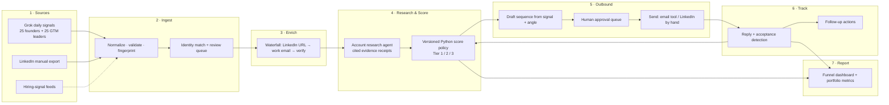
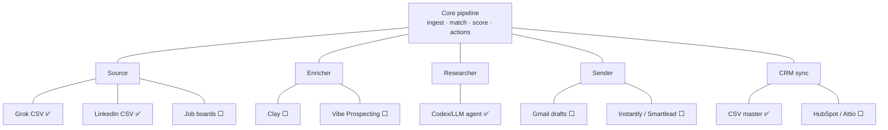
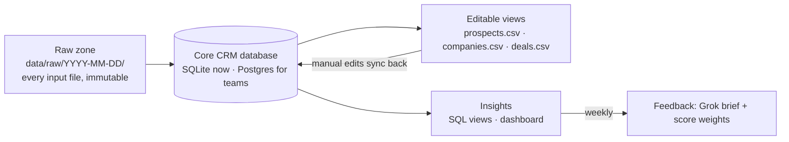

# Architecture

A signal-based GTM engine that finds B2B SaaS buyers with a fresh reason to talk, turns
them into a reliable work queue, and runs human-approved outreach. I use it on my own
remote job and contract search; it is built so a startup can swap in its own sources,
enrichment vendors, sending tools, and CRM.

**Status legend:** ✅ built and tested · 🟡 in progress · ⬜ planned

## ICP

| Segment | Who | Signals that qualify them |
|---|---|---|
| Founders | Founder, Co-founder, CEO at seed–Series B B2B SaaS | New funding, launch, first GTM hire, pipeline/outbound pain posted publicly |
| GTM leaders | Head-level and C-suite in **marketing, content, or sales**: CMO, CRO, Chief Growth/Content/Commercial, VP or Head of Marketing, Sales, Content, Growth, Demand, Revenue, GTM | New in role, team expansion, GTM Engineer / RevOps / Marketing Ops job post |

Excluded: individual contributors, Directors and below, SDRs/AEs, investors.
Encoded in [`docs/grok-brief.md`](grok-brief.md) (sourcing) and `config/gtm.yaml`
(`decision_maker_rule`: seniority × function).

## Pipeline

| Stage | What it does | Status |
|---|---|---|
| 1 Sources | Grok scheduled task drops dated CSVs into `data/incoming/grok/{founders,VPs}/`; LinkedIn CSVs into `data/incoming/linkedin/` | ✅ Grok, LinkedIn · ⬜ hiring-signal feeds |
| 2 Ingest | Header mapping, Pydantic validation, content fingerprints so reruns never duplicate, deterministic identity match (email / LinkedIn URL), ambiguous matches held for review | ✅ |
| 3 Enrich | Fill missing LinkedIn URL and work email through a provider waterfall (Clay → Vibe Prospecting → manual), verify email deliverability, record which provider supplied each field | ⬜ next |
| 4 Research & Score | Optional agent researches each **account** once and returns cited evidence; fixed Python policy computes account fit, lead fit, intent, engagement → tier and next action. Missing evidence stays unscored, never guessed | ✅ policy and receipts · 🟡 automatic research of new accounts |
| 5 Outbound | Generate a 3-touch email sequence and a LinkedIn connection note from each person's `signal` and `outreach_angle`; nothing sends without approval | ⬜ |
| 6 Track | Replies and connection acceptance update status, engagement score, and follow-up dates; DNC and closed people get no actions | ✅ manual logging and follow-ups · ⬜ automatic reply detection |
| 7 Report | Aggregate funnel metrics without exposing prospect data | ✅ `gtm portfolio-report` · ⬜ live dashboard |

## Components and adapters

The core never calls a vendor directly. Each external system sits behind a small
interface, so a startup can replace any box without touching the pipeline.

| Interface | Contract |
|---|---|
| `Source` | Yields raw rows plus a stable file fingerprint |
| `Enricher` | Given a person, returns fields found with provider name and confidence; never overwrites manual edits |
| `Researcher` | Given a company domain, returns a structured, cited receipt validated against a JSON schema |
| `Sender` | Creates drafts or enqueues approved messages; returns external message IDs for reply matching |
| `CRM` | Exports the person row and activity history; the engine stays the system of record for scoring |

## Data storage and CRM model

### Today

| Data | Where | Queryable? |
|---|---|---|
| Raw Grok / LinkedIn files | `data/incoming/` (originals), `data/processed/` (managed snapshots) | file by file |
| People (current state) | `data/prospects.csv` | yes, in Excel |
| Per-person history | JSON inside `source_data` / `activity_history` columns | barely |
| Account research | `data/research/accounts/`, `data/research/history/` | file by file |
| Import runs, fingerprints | `data/state/local.sqlite` (no contact data) | yes |
| Master versions | `data/backups/` (last 30) | recovery only |
| Config | `config/gtm.yaml` (mappings, stages, cadence, ICP rule, weights) | versioned |

**Gap:** one `signal` column per person. A newer signal for an existing person only
fills blanks, so it is buried in `source_data` and never reaches scoring or outreach.
Sends and replies are not rows, so "which signal gets replies?" cannot be answered.

### Target: three zones

The database is the system of record. CSVs are generated views; edits made in them are
validated and written back. Every write is still backed up and atomic.

### CRM tables and columns

**companies** (accounts)

| Column | Notes |
|---|---|
| `company_id`, `name`, `domain`, `website`, `linkedin_company_url` | domain is the account key |
| `industry`, `sub_vertical`, `business_model` | e.g. B2B SaaS / SecOps |
| `employee_count`, `employee_range` | |
| `funding_stage`, `total_funding_usd`, `last_funding_date`, `last_funding_amount_usd`, `investors` | |
| `hq_country`, `hq_city` | |
| `crm_tool`, `marketing_automation_tool`, `sales_engagement_tool`, `data_tools` | technographics |
| `hiring_gtm_roles`, `open_gtm_roles_count`, `careers_url` | hiring signal summary |
| `icp_fit` (strong/moderate/weak), `account_tier`, `account_score` | from score policy |
| `lifecycle_stage` | target → engaged → opportunity → customer / lost / nurture |
| `owner`, `original_source`, `created_at`, `updated_at` | |

**people** (contacts)

| Column | Notes |
|---|---|
| `person_id`, `company_id` | |
| `first_name`, `last_name`, `full_name`, `job_title` | |
| `seniority` (founder / c_suite / vp / head), `function` (founder / marketing / content / sales / revenue) | derived from title rule |
| `segment` (founders / gtm_leaders) | |
| `email`, `email_status` (verified / risky / invalid / unknown), `email_source` | |
| `linkedin_url`, `x_handle`, `country`, `city`, `timezone` | |
| `lifecycle_stage` | new → contactable → contacted → engaged → meeting → opportunity → won / lost / nurture |
| `lead_status` (open / in_sequence / replied / unresponsive / bad_fit) | |
| `connection_status` (none / requested / connected) | LinkedIn |
| `reply_status` (none / positive / neutral / negative / ooo) | latest reply |
| `touches_count`, `last_contacted_at`, `last_replied_at`, `next_followup_at` | |
| `lead_score`, `tier`, `score_model_version` | |
| `consulting_stage`, `job_stage` | two independent pipelines, as today |
| `do_not_contact`, `unsubscribed_at`, `bounce_count` | compliance |
| `owner`, `notes`, `original_source`, `created_at`, `updated_at` | |

**signals** (append-only — the heart of signal-based outbound)

| Column | Notes |
|---|---|
| `signal_id`, `person_id`, `company_id` | person optional for company-level signals |
| `signal_type` | funding / new_role / job_post / launch / pain_post / expansion / other |
| `summary`, `signal_date`, `source_url`, `source` (grok / linkedin / job_board) | |
| `strength` (strong / moderate / weak), `first_seen_at`, `expires_at` | freshness window, default 30 days |
| `why_fit`, `outreach_angle` | from Grok |
| `used_in_message_id` | which touch used it |

**deals** (opportunities — consulting contracts and job opportunities)

| Column | Notes |
|---|---|
| `deal_id`, `company_id`, `primary_person_id` | |
| `pipeline` (consulting / job), `stage` | stages from `config/gtm.yaml` |
| `engagement_type` (full_time / contract / project), `role_title`, `job_post_url` | |
| `amount`, `currency`, `rate_type` (salary / hourly / fixed) | |
| `expected_close_date`, `closed_at`, `lost_reason`, `next_step` | |
| `created_from_signal_id`, `created_at`, `updated_at` | attribution |

**messages** (every touch)

| Column | Notes |
|---|---|
| `message_id`, `person_id`, `signal_id`, `deal_id` | |
| `channel` (email / linkedin), `sequence_name`, `step` (1–3) | |
| `angle`, `template_version`, `subject`, `body` | |
| `status` (draft / approved / sent / bounced / cancelled) | |
| `approved_at`, `sent_at`, `external_message_id`, `thread_id` | for reply matching |

**events** (activities — observed facts only)

| Column | Notes |
|---|---|
| `event_id`, `person_id`, `deal_id`, `message_id` | |
| `event_type` | connection_requested / connection_accepted / reply / positive_reply / meeting_booked / meeting_held / interview / offer / hired / won / lost / unsubscribe / bounce / note |
| `occurred_at`, `recorded_by` (human / sync), `notes` | |

**tasks** (follow-ups): `task_id`, `person_id`, `deal_id`, `type`, `due_at`, `status`,
`completed_at`, `rule` — replaces today's derived action hashes.

**enrichment**: `entity_type`, `entity_id`, `field`, `value`, `provider`, `confidence`,
`found_at` — provenance for every enriched value.

**score_snapshots**: `person_id`, `snapshot_date`, component scores, `tier`,
`model_version` — lets us check whether Tier 1 actually converts.

### Reading past data

- `gtm sql "<query>"` or `sqlite3` for ad-hoc questions.
- Datasette to browse and filter every table in the browser.
- Saved SQL views feeding the dashboard:
  - reply and positive-reply rate by `signal_type` and by segment
  - reply rate by signal age at send (does 3 days beat 20?)
  - best-performing `angle` and `template_version`
  - signal stacking: companies with 2+ fresh signals (e.g. funding + new CMO)
  - funnel: discovered → contactable → contacted → replied → meeting → deal → won/hired
  - deals by pipeline and stage, with source signal
- Weekly feedback: winning signal types go into `docs/grok-brief.md`; score weights in
  `config/gtm.yaml` are tuned from observed outcomes.

### Migration

Current `prospects.csv` columns map onto `people`, `companies`, and `signals`
(`signal`, `signal_date`, `source_url`, `why_fit`, `outreach_angle` become each person's
first signal row; `source_data` history is replayed into further signal rows).
`activity_history` becomes `events`. Existing IDs are kept. The old CSV stays readable.

## Outbound design (planned)

- **Email:** 3 touches over ~10 days. Touch 1 references the signal; touch 2 adds one
  relevant proof point; touch 3 is a short close-the-loop. Sent from a secondary, warmed
  domain at 30–50 per inbox per day.
- **LinkedIn:** the system writes the connection note; I send it by hand, 15–20 per day.
  No LinkedIn automation.
- **Approval:** drafts land in a queue (Gmail drafts or the sending tool) and go out only
  after review. The LLM never marks a message as sent or invents a reply.
- **Reply detection:** poll the inbox, match by message ID, set `connection_status`,
  update engagement score, and stop the sequence.

## Scheduling

| Job | Today | Planned |
|---|---|---|
| Grok sourcing | Grok scheduled task | same |
| Import | macOS LaunchAgent every 15 min (`gtm scheduler install`) | GitHub Actions cron |
| Enrichment + research of new accounts | manual | nightly after import |
| Draft generation | — | nightly, into approval queue |
| Reply sync | — | every 30 min |
| Daily briefing | `gtm daily` | pushed to email or Slack |

## Guarantees

- **Idempotent imports.** Files and rows are fingerprinted; rerunning or re-dropping the
  same file never creates duplicates. Originals stay untouched in the inbox.
- **Crash-safe writes.** Master is written to a temp file, fsynced, and atomically
  replaced, with a backup taken first. Each row is committed to the CSV before its
  checkpoint, so a crash can't double-create.
- **Conservative identity.** Only exact email or normalized LinkedIn URL auto-merge.
  Name + company only suggests a duplicate for review.
- **Manual edits win.** New observations fill blanks and append notes; they never
  overwrite user-entered values.
- **Explainable scores.** The model gathers cited evidence; fixed, versioned Python rules
  compute the score. Profile or policy changes invalidate cached judgments.
- **Humans own outcomes.** Replies, acceptances, and sends are observed events, never
  model output. DNC excludes a person from all actions.
- **Private by default.** Prospect data, state, research, and `.env` are git-ignored; the
  portfolio report exports aggregates only.

## Roadmap

1. ✅ Repo, backup rotation, file-naming contract, Grok brief, ICP rule
2. ⬜ Enrichment waterfall (Clay, Vibe Prospecting) with provenance and email verification
3. ⬜ Data layer: CRM database (companies, people, signals, deals, messages, events,
   tasks, enrichment, score_snapshots), raw zone, CSV views, migration, `gtm sql`
4. ⬜ Outbound drafts, approval queue, reply detection — writing to messages/events
5. ⬜ Adapters, GitHub Actions scheduling, automatic research of new accounts
6. ⬜ Insights views + dashboard, demo mode with synthetic data, walkthrough video
