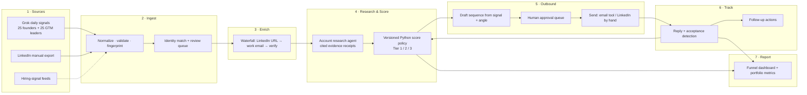
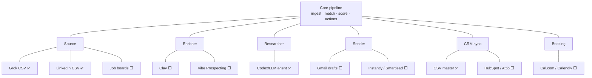
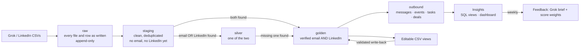
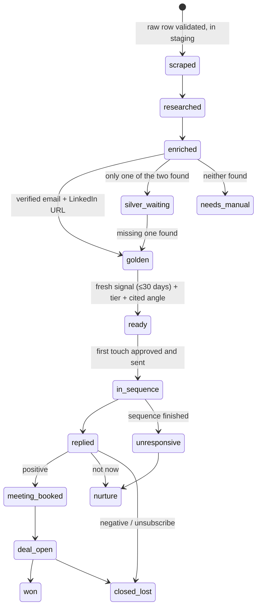

# Architecture

A signal-based GTM engine that finds B2B SaaS buyers with a fresh reason to talk, turns
them into a reliable work queue, and runs human-approved outreach. I use it on my own
remote job and contract search; it is built so a startup can swap in its own sources,
enrichment vendors, sending tools, and CRM.

**Status legend:** ✅ built and tested · 🟡 in progress · ⬜ planned

## End goal

Every person the lead-gen engine finds is tracked from first sighting to outcome, with
nothing "on air":

1. **Capture** every scraped person and their signal.
2. **Research** the person and their company, with cited sources.
3. **Store** everything in one hosted warehouse (Postgres).
4. **Enrich** through AI and tools connected to that warehouse.
5. **Run outbound** whose message is based on that research.
6. **Track the pipeline** to results: positive replies, calls booked, deals, offers.

Every step writes a record (who/what/when/which run/which model), every person is always
in exactly one lifecycle state, and anyone stuck too long is surfaced daily.

**Result metrics:** contactable rate, sent, reply rate, **positive reply rate**,
**calls booked**, deals opened, won / hired, and time from signal to call.

## ICP

| Segment | Who | Signals that qualify them |
|---|---|---|
| Founders | Founder, Co-founder, CEO at seed–Series B B2B SaaS | New funding, launch, first GTM hire, pipeline/outbound pain posted publicly |
| GTM leaders | Head-level and C-suite in **marketing, content, or sales**: CMO, CRO, Chief Growth/Content/Commercial, VP or Head of Marketing, Sales, Content, Growth, Demand, Revenue, GTM | New in role, team expansion, GTM Engineer / RevOps / Marketing Ops job post |

Excluded: individual contributors, Directors and below, SDRs/AEs, investors.
Encoded in [`docs/grok-brief.md`](grok-brief.md) (sourcing) and `config/gtm.yaml`
(`decision_maker_rule`: seniority × function).

## Pipeline



| Stage | What it does | Status |
|---|---|---|
| 1 Sources | Grok scheduled task drops dated CSVs into `data/incoming/grok/{founders,VPs}/`; LinkedIn CSVs into `data/incoming/linkedin/` | ✅ Grok, LinkedIn · ⬜ hiring-signal feeds |
| 2 Ingest | Header mapping, Pydantic validation, content fingerprints so reruns never duplicate, deterministic identity match (email / LinkedIn URL), ambiguous matches held for review | ✅ |
| 3 Enrich | Fill missing LinkedIn URL and work email through a provider waterfall (Clay → Vibe Prospecting → manual), verify email deliverability, record which provider supplied each field; promote staging → silver → golden | ⬜ next |
| 4 Research & Score | **Account research** (once per company: hiring, funding, tools) and **person research** (recent posts, talks, role history, public priorities), both with cited sources; fixed Python policy computes account fit, lead fit, intent, engagement → tier and next action. Missing evidence stays unscored, never guessed | ✅ account receipts and policy · ⬜ person research · 🟡 automatic research of new accounts |
| 5 Outbound | Generate a 3-touch email sequence and a LinkedIn connection note from each **golden** person's `signal` and `outreach_angle`; nothing sends without approval | ⬜ |
| 6 Track | Replies, connection acceptance, and **calls booked** (Cal.com/Calendly webhook) update status, engagement score, deals, and follow-ups; DNC and closed people get no actions | ✅ manual logging and follow-ups · ⬜ reply detection · ⬜ booking webhook |
| 7 Report | Aggregate funnel metrics without exposing prospect data | ✅ `gtm portfolio-report` · ⬜ live dashboard |

## Components and adapters

The core never calls a vendor directly. Each external system sits behind a small
interface, so a startup can replace any box without touching the pipeline.



| Interface | Contract |
|---|---|
| `Source` | Yields raw rows plus a stable file fingerprint |
| `Enricher` | Given a person, returns fields found with provider name and confidence; never overwrites manual edits |
| `Researcher` | Given a company domain, returns a structured, cited receipt validated against a JSON schema |
| `Sender` | Creates drafts or enqueues approved messages; returns external message IDs for reply matching |
| `CRM` | Exports the person row and activity history; the engine stays the system of record for scoring |
| `Booking` | Receives Cal.com/Calendly webhooks, matches the invitee to a person, writes `meeting_booked` / `meeting_held` events |

## Data storage and CRM model

### Today

| Data | Where | Queryable? |
|---|---|---|
| Raw Grok / LinkedIn files | `data/incoming/` (originals), `data/processed/` (managed snapshots) | file by file |
| People (current state) | `data/prospects.csv` | yes, in Excel |
| Per-person history | JSON inside `source_data` / `activity_history` columns | barely |
| Account research | `data/research/accounts/`, `data/research/history/` | file by file |
| Import runs, fingerprints | `data/state/local.sqlite` (no contact data) | yes |
| Master versions | `data/backups/` (last 30) | recovery only |
| Config | `config/gtm.yaml` (mappings, stages, cadence, ICP rule, weights) | versioned |

**Gap:** one `signal` column per person. A newer signal for an existing person only
fills blanks, so it is buried in `source_data` and never reaches scoring or outreach.
Sends and replies are not rows, so "which signal gets replies?" cannot be answered.

### Target: layered warehouse (raw → staging → silver → golden)



**Neon Postgres is the system of record.** It was picked over local SQLite because
webhooks (Clay, Cal.com), cloud scheduled jobs and AI tools must all reach it, and over
Supabase because of instant copy-on-write branches: migrations, data migration and tests run
on a branch first. One database, one schema per layer. Schema changes go through versioned
migrations. `DATABASE_URL` lives only in `.env` and GitHub Actions secrets. Raw files are
also copied unchanged to `data/raw/YYYY-MM-DD/` and mirrored to object storage. Daily
backups: provider point-in-time recovery plus a nightly dump. Postgres stays the system of
record at scale. If heavy analytics are ever needed, a copy streams to a columnar warehouse
for reporting only.

| Schema | Holds | Rule |
|---|---|---|
| `raw` | `files`, `grok_rows`, `provider_responses` | Append-only. Nothing is edited or deleted. Rows that fail validation still land here, with the errors. |
| `core` | `prospect_registry`, `companies`, `signals`, `enrichment`, `person_research`, `account_research`, `score_snapshots` | Data about a person or account at any layer |
| `staging` | `prospects` | Clean, deduplicated, no email and no LinkedIn URL yet |
| `silver` | `prospects` | Verified email **or** LinkedIn URL, not both |
| `golden` | `prospects` | Verified email **and** LinkedIn URL. **Outbound reads only this.** |
| `outbound` | `messages`, `events`, `tasks`, `deals` | Every row points to a golden prospect |
| `ops` | `pipeline_runs`, `state_transitions`, `ai_outputs` | Observability across all layers |

#### Grok column contract is kept in every layer

The Grok bot writes 13 columns:
`name, title, company, company_website, country, city, linkedin_url, x_handle, source_url, signal, signal_date, why_fit, outreach_angle`.

- `raw.grok_rows` stores the 13 columns exactly as written, all as text. The only extra
  columns are `raw_row_id`, `file_id`, `row_number`, `segment` (founders / VPs),
  `ingested_at`, `validation_status` and `validation_errors`.
- `staging.prospects`, `silver.prospects` and `golden.prospects` share **one identical
  column set**. It starts with the same 13 names, validated and typed (`signal_date` as a
  date, `linkedin_url` normalized). The 5 signal columns on a prospect hold the latest
  signal; the full history is in `core.signals`.
- Columns that Grok does not supply are appended after the 13 and never rename them.

#### Promotion rules

| Layer | Requires |
|---|---|
| `staging` | Passes validation, `name`, `title`, `company`, identity resolved (no open duplicate review) |
| `silver` | Staging requirements **and** (`email_status = verified` **or** `linkedin_url`) |
| `golden` | Staging requirements **and** `email_status = verified` **and** `linkedin_url` |

- Each person has **one `prospect_id` for life**, registered in `core.prospect_registry`
  with their current `layer`. They live in exactly one of `staging`, `silver` or `golden`
  at a time.
- Promotion moves the row, updates `layer` and writes a `state_transitions` row in one
  transaction. Enrichment only searches for what is missing (silver needs one field).
- Check constraints enforce each layer's requirements in the database, not only in code.
- A golden prospect with outbound history is never moved out. A later bounce sets
  `email_status = bounced`, which blocks email sends; LinkedIn stays allowed.

#### Foreign keys and CRM hygiene

```
core.prospect_registry (prospect_id)
 ├── staging / silver / golden .prospects   prospect_id → registry
 ├── core.signals, core.enrichment, core.person_research, core.score_snapshots
 ├── ops.state_transitions, ops.ai_outputs (entity = prospect)
 └── golden.prospects (prospect_id)
      ├── outbound.messages   prospect_id → golden.prospects, signal_id → core.signals
      ├── outbound.events     prospect_id → golden.prospects, message_id → messages
      ├── outbound.tasks      prospect_id → golden.prospects
      └── outbound.deals      primary_prospect_id → golden.prospects
```

- Data created before a person is golden (signals, enrichment, research, transitions)
  points to the registry, so it never breaks when the person moves layers. Outbound
  points to `golden.prospects`, so nothing can be drafted or sent to a non-golden person.
- Referenced prospects cannot be deleted (`ON DELETE RESTRICT`). Opt-outs set
  `do_not_contact`; history stays.
- Unique normalized `linkedin_url` and unique `email` across all three prospect tables.
- Check constraints on every status column (`layer`, `email_status`, `tier`,
  `lifecycle_stage`, `lead_status`, `reply_status`, `channel`, `event_type`).
- `lifecycle_stage` changes only through transition code that writes `state_transitions`.
  `updated_at` is set by trigger.
- `pipeline_runs` describes a whole job, so it has no prospect key.

### CRM tables and columns

**prospects** (`staging`, `silver`, `golden`: identical columns)

| Column | Notes |
|---|---|
| `prospect_id`, `company_id` | |
| `name`, `title`, `company`, `company_website`, `country`, `city`, `linkedin_url`, `x_handle`, `source_url`, `signal`, `signal_date`, `why_fit`, `outreach_angle` | **Grok contract, same names and order** |
| `segment` (founders / VPs) | from the Grok folder |
| `email`, `email_status` (verified / risky / invalid / bounced / unknown), `email_source`, `domain` | |
| `seniority` (founder / c_suite / vp / head), `function` (founder / marketing / content / sales / revenue) | derived from title rule |
| `timezone` | |
| `lifecycle_stage` | new → contactable → contacted → engaged → meeting → opportunity → won / lost / nurture |
| `lead_status` (open / in_sequence / replied / unresponsive / bad_fit) | |
| `connection_status` (none / requested / connected) | LinkedIn |
| `reply_status` (none / positive / neutral / negative / ooo) | latest reply |
| `touches_count`, `last_contacted_at`, `last_replied_at`, `next_followup_at` | |
| `lead_score`, `tier`, `score_model_version` | |
| `consulting_stage`, `job_stage` | two independent pipelines, as today |
| `do_not_contact`, `unsubscribed_at`, `bounce_count` | compliance |
| `owner`, `notes`, `original_source`, `created_at`, `updated_at` | |

**core.prospect_registry**: `prospect_id`, `layer` (staging / silver / golden),
`first_raw_row_id`, `created_at`, `promoted_at`.

**core.companies** (accounts)

| Column | Notes |
|---|---|
| `company_id`, `name`, `domain`, `website`, `linkedin_company_url` | domain is the account key |
| `industry`, `sub_vertical`, `business_model` | e.g. B2B SaaS / SecOps |
| `employee_count`, `employee_range` | |
| `funding_stage`, `total_funding_usd`, `last_funding_date`, `last_funding_amount_usd`, `investors` | |
| `hq_country`, `hq_city` | |
| `crm_tool`, `marketing_automation_tool`, `sales_engagement_tool`, `data_tools` | technographics |
| `hiring_gtm_roles`, `open_gtm_roles_count`, `careers_url` | hiring signal summary |
| `icp_fit` (strong/moderate/weak), `account_tier`, `account_score` | from score policy |
| `lifecycle_stage` | target → engaged → opportunity → customer / lost / nurture |
| `owner`, `original_source`, `created_at`, `updated_at` | |

**core.signals** (append-only, the heart of signal-based outbound; Grok names kept)

| Column | Notes |
|---|---|
| `signal_id`, `prospect_id`, `company_id`, `raw_row_id` | prospect optional for company-level signals |
| `signal`, `signal_date`, `source_url`, `why_fit`, `outreach_angle` | Grok names |
| `signal_type` | funding / new_role / job_post / launch / pain_post / expansion / other |
| `source` (grok / linkedin / job_board) | |
| `strength` (strong / moderate / weak), `first_seen_at`, `expires_at` | freshness window, default 30 days |
| `used_in_message_id` | which touch used it |

**outbound.deals** (opportunities: consulting contracts and job opportunities)

| Column | Notes |
|---|---|
| `deal_id`, `company_id`, `primary_prospect_id` | |
| `pipeline` (consulting / job), `stage` | stages from `config/gtm.yaml` |
| `engagement_type` (full_time / contract / project), `role_title`, `job_post_url` | |
| `amount`, `currency`, `rate_type` (salary / hourly / fixed) | |
| `expected_close_date`, `closed_at`, `lost_reason`, `next_step` | |
| `created_from_signal_id`, `created_at`, `updated_at` | attribution |

**outbound.messages** (every touch)

| Column | Notes |
|---|---|
| `message_id`, `prospect_id`, `signal_id`, `deal_id`, `ai_output_id` | |
| `channel` (email / linkedin), `sequence_name`, `step` (1–3) | |
| `angle`, `template_version`, `subject`, `body` | |
| `status` (draft / approved / sent / bounced / cancelled) | |
| `approved_at`, `sent_at`, `external_message_id`, `thread_id` | for reply matching |

**outbound.events** (activities, observed facts only)

| Column | Notes |
|---|---|
| `event_id`, `prospect_id`, `deal_id`, `message_id` | |
| `event_type` | connection_requested / connection_accepted / reply / positive_reply / meeting_booked / meeting_held / interview / offer / hired / won / lost / unsubscribe / bounce / note |
| `occurred_at`, `recorded_by` (human / sync), `notes` | |

**outbound.tasks** (follow-ups): `task_id`, `prospect_id`, `deal_id`, `type`, `due_at`,
`status`, `completed_at`, `rule`. Replaces today's derived action hashes.

**raw.provider_responses**: `response_id`, `provider`, `prospect_id`, `request`,
`response`, `run_id`, `received_at`. Every enrichment call's payload, unchanged.

**core.enrichment**: `prospect_id` or `company_id`, `field`, `value`, `provider`,
`confidence`, `found_at`, `response_id`. Provenance for every enriched value.

**core.score_snapshots**: `prospect_id`, `snapshot_date`, component scores, `tier`,
`model_version`. Lets us check whether Tier 1 actually converts.

**core.person_research**: `research_id`, `prospect_id`, `researched_at`, `recent_posts`
(summaries + URLs), `talks_podcasts`, `role_history`, `stated_priorities`,
`personalization_hooks`, `sources` (URLs), `confidence`, `ai_output_id`. Outreach angles
must cite at least one source from here or from account research.

**core.account_research**: today's JSON receipts moved into a table: `company_id`,
`researched_at`, findings with sources, `status`, `profile_hash`, `ai_output_id`.

**ops.state_transitions**: `prospect_id`, `from_layer`, `to_layer`, `from_state`,
`to_state`, `at`, `run_id`, `actor` (system / human), `reason`. Full history of every
person's journey through layers and lifecycle stages.

**ops.pipeline_runs**: `run_id`, `job` (import / enrich / promote / research / draft /
reply_sync / booking), `started_at`, `finished_at`, `status`, `rows_in`, `rows_ok`,
`rows_failed`, `error_summary`.

**ops.ai_outputs**: `ai_output_id`, `task` (research / angle / draft / classify_reply),
`entity_type`, `entity_id`, `model`, `prompt_version`, `input_hash`, `output`,
`sources`, `run_id`, `created_at`. Every AI result is stored and traceable.

### Person lifecycle and observability



- Each person is in exactly one layer and one state; every change writes a
  `state_transitions` row.
- Golden is about data quality, `ready` is about timing. A golden person whose signal is
  older than 30 days stays golden but gets no outreach until a fresh signal arrives.
- Every job writes a `pipeline_runs` row; every AI call writes an `ai_outputs` row.
- **Daily "stuck" report:** people over the time limit in a state (e.g. `scraped` > 2
  days, `ready` > 3 days, `replied` without follow-up > 1 day), failed runs, and
  enrichment gaps. Nothing silently drops out.
- **Lineage:** any message can be traced to its signal, research sources, AI output,
  prompt version, and approval.

### Reading past data

- `gtm sql "<query>"`, `psql`, or the Neon SQL editor for ad-hoc questions.
- Neon console tables view (or Metabase) to browse and filter every table.
- A read-only Postgres MCP connection so Claude can answer questions over the
  warehouse ("which signals got positive replies this month?").
- Saved SQL views feeding the dashboard:
  - reply and positive-reply rate by `signal_type` and by segment
  - reply rate by signal age at send (does 3 days beat 20?)
  - best-performing `angle` and `template_version`
  - signal stacking: companies with 2+ fresh signals (e.g. funding + new CMO)
  - funnel: discovered → contactable → contacted → replied → meeting → deal → won/hired
  - deals by pipeline and stage, with source signal
- Weekly feedback: winning signal types go into `docs/grok-brief.md`; score weights in
  `config/gtm.yaml` are tuned from observed outcomes.

### Migration

Current `prospects.csv` columns map onto `prospects`, `companies`, and `signals`, renamed
to the Grok contract (`full_name` → `name`, `job_title` → `title`, `company_name` →
`company`, `website` → `company_website`). `signal`, `signal_date`, `source_url`,
`why_fit`, `outreach_angle` become each person's first signal row; `source_data` history
is replayed into further signal rows. Each person is placed in `staging`, `silver` or
`golden` by the promotion rules. Original Grok files are loaded into `raw`.
`activity_history` becomes `events`. Existing IDs become `prospect_id`. The old CSV stays
readable. The migration runs on a Neon branch first, with row counts per layer before and
after.

## Outbound design (planned)

- **Email:** 3 touches over ~10 days. Touch 1 references the signal; touch 2 adds one
  relevant proof point; touch 3 is a short close-the-loop. Sent from a secondary, warmed
  domain at 30–50 per inbox per day.
- **LinkedIn:** the system writes the connection note; I send it by hand, 15–20 per day.
  No LinkedIn automation.
- **Approval:** drafts land in a queue (Gmail drafts or the sending tool) and go out only
  after review. The LLM never marks a message as sent or invents a reply.
- **Reply detection:** poll the inbox, match by message ID, set `connection_status`,
  update engagement score, and stop the sequence.

## Scheduling

| Job | Today | Planned |
|---|---|---|
| Grok sourcing | Grok scheduled task | same |
| Import | macOS LaunchAgent every 15 min (`gtm scheduler install`) | GitHub Actions cron |
| Enrichment + research of new accounts | manual | nightly after import |
| Draft generation | — | nightly, into approval queue |
| Booking webhooks | — | Cal.com/Calendly → events, instantly |
| Stuck report | — | daily, emailed with the briefing |
| Reply sync | — | every 30 min |
| Daily briefing | `gtm daily` | pushed to email or Slack |

## Guarantees

- **Idempotent imports.** Files and rows are fingerprinted; rerunning or re-dropping the
  same file never creates duplicates. Originals stay untouched in the inbox.
- **Crash-safe writes.** Master is written to a temp file, fsynced, and atomically
  replaced, with a backup taken first. Each row is committed to the CSV before its
  checkpoint, so a crash can't double-create.
- **Conservative identity.** Only exact email or normalized LinkedIn URL auto-merge.
  Name + company only suggests a duplicate for review.
- **Manual edits win.** New observations fill blanks and append notes; they never
  overwrite user-entered values.
- **Explainable scores.** The model gathers cited evidence; fixed, versioned Python rules
  compute the score. Profile or policy changes invalidate cached judgments.
- **Humans own outcomes.** Replies, acceptances, and sends are observed events, never
  model output. DNC excludes a person from all actions.
- **Nothing on air.** Every job, AI output, and state change is logged with a run ID.
- **Private by default.** Prospect data, state, research, and `.env` are git-ignored; the
  portfolio report exports aggregates only.

## Roadmap

1. ✅ Repo, backup rotation, file-naming contract, Grok brief, ICP rule
2. ⬜ Warehouse: Neon Postgres with raw → staging → silver → golden layers, `core`,
   `outbound` and `ops` schemas; Grok column contract in every layer; promotion job;
   CSV views; migration of existing data; `gtm sql`
3. ⬜ Enrichment waterfall (Clay, Vibe Prospecting) and person research, writing
   provenance and sources to the warehouse
4. ⬜ Outbound drafts from research, approval queue, reply detection, booking webhook
5. ⬜ Adapters, GitHub Actions scheduling, automatic research, daily stuck report
6. ⬜ Insights views + dashboard, demo mode with synthetic data, walkthrough video
