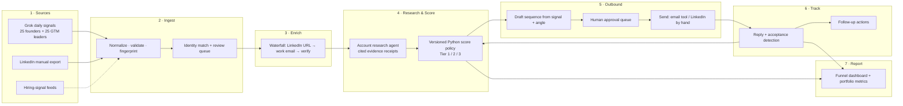
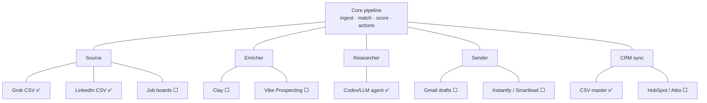

# Architecture

A signal-based GTM engine that finds B2B SaaS buyers with a fresh reason to talk, turns
them into a reliable work queue, and runs human-approved outreach. I use it on my own
remote job and contract search; it is built so a startup can swap in its own sources,
enrichment vendors, sending tools, and CRM.

**Status legend:** ✅ built and tested · 🟡 in progress · ⬜ planned

## ICP

| Segment | Who | Signals that qualify them |
|---|---|---|
| Founders | Founder, Co-founder, CEO at seed–Series B B2B SaaS | New funding, launch, first GTM hire, pipeline/outbound pain posted publicly |
| GTM leaders | Head-level and C-suite in **marketing, content, or sales**: CMO, CRO, Chief Growth/Content/Commercial, VP or Head of Marketing, Sales, Content, Growth, Demand, Revenue, GTM | New in role, team expansion, GTM Engineer / RevOps / Marketing Ops job post |

Excluded: individual contributors, Directors and below, SDRs/AEs, investors.
Encoded in [`docs/grok-brief.md`](grok-brief.md) (sourcing) and `config/gtm.yaml`
(`decision_maker_rule`: seniority × function).

## Pipeline

| Stage | What it does | Status |
|---|---|---|
| 1 Sources | Grok scheduled task drops dated CSVs into `data/incoming/grok/{founders,VPs}/`; LinkedIn CSVs into `data/incoming/linkedin/` | ✅ Grok, LinkedIn · ⬜ hiring-signal feeds |
| 2 Ingest | Header mapping, Pydantic validation, content fingerprints so reruns never duplicate, deterministic identity match (email / LinkedIn URL), ambiguous matches held for review | ✅ |
| 3 Enrich | Fill missing LinkedIn URL and work email through a provider waterfall (Clay → Vibe Prospecting → manual), verify email deliverability, record which provider supplied each field | ⬜ next |
| 4 Research & Score | Optional agent researches each **account** once and returns cited evidence; fixed Python policy computes account fit, lead fit, intent, engagement → tier and next action. Missing evidence stays unscored, never guessed | ✅ policy and receipts · 🟡 automatic research of new accounts |
| 5 Outbound | Generate a 3-touch email sequence and a LinkedIn connection note from each person's `signal` and `outreach_angle`; nothing sends without approval | ⬜ |
| 6 Track | Replies and connection acceptance update status, engagement score, and follow-up dates; DNC and closed people get no actions | ✅ manual logging and follow-ups · ⬜ automatic reply detection |
| 7 Report | Aggregate funnel metrics without exposing prospect data | ✅ `gtm portfolio-report` · ⬜ live dashboard |

## Components and adapters

The core never calls a vendor directly. Each external system sits behind a small
interface, so a startup can replace any box without touching the pipeline.

| Interface | Contract |
|---|---|
| `Source` | Yields raw rows plus a stable file fingerprint |
| `Enricher` | Given a person, returns fields found with provider name and confidence; never overwrites manual edits |
| `Researcher` | Given a company domain, returns a structured, cited receipt validated against a JSON schema |
| `Sender` | Creates drafts or enqueues approved messages; returns external message IDs for reply matching |
| `CRM` | Exports the person row and activity history; the engine stays the system of record for scoring |

## Data model

| Store | Holds | Notes |
|---|---|---|
| `data/prospects.csv` | One row per person: identity, company, signal, stages, scores, activity history | Editable in Excel/Numbers; atomic writes; last 30 versions in `data/backups/` |
| `data/state/local.sqlite` | Import runs, file/row fingerprints, outcomes, audit metadata | No contact data |
| `data/research/` | Per-account evidence receipts and history | Shared by every contact at the account |
| `config/gtm.yaml` | Header mappings, stages, follow-up cadence, ICP rule, score weights | Versioned with the code |

Two pipelines run on the same person row and do not interfere: `consulting_stage`
(identified → won/lost) and `job_stage` (identified → hired/rejected).

**Planned change:** move the system of record into SQLite (Postgres for multi-user) and
treat the CSV as an export and editing view. This removes the rule that the spreadsheet
must be closed during imports and is the prerequisite for team use.

## Outbound design (planned)

- **Email:** 3 touches over ~10 days. Touch 1 references the signal; touch 2 adds one
  relevant proof point; touch 3 is a short close-the-loop. Sent from a secondary, warmed
  domain at 30–50 per inbox per day.
- **LinkedIn:** the system writes the connection note; I send it by hand, 15–20 per day.
  No LinkedIn automation.
- **Approval:** drafts land in a queue (Gmail drafts or the sending tool) and go out only
  after review. The LLM never marks a message as sent or invents a reply.
- **Reply detection:** poll the inbox, match by message ID, set `connection_status`,
  update engagement score, and stop the sequence.

## Scheduling

| Job | Today | Planned |
|---|---|---|
| Grok sourcing | Grok scheduled task | same |
| Import | macOS LaunchAgent every 15 min (`gtm scheduler install`) | GitHub Actions cron |
| Enrichment + research of new accounts | manual | nightly after import |
| Draft generation | — | nightly, into approval queue |
| Reply sync | — | every 30 min |
| Daily briefing | `gtm daily` | pushed to email or Slack |

## Guarantees

- **Idempotent imports.** Files and rows are fingerprinted; rerunning or re-dropping the
  same file never creates duplicates. Originals stay untouched in the inbox.
- **Crash-safe writes.** Master is written to a temp file, fsynced, and atomically
  replaced, with a backup taken first. Each row is committed to the CSV before its
  checkpoint, so a crash can't double-create.
- **Conservative identity.** Only exact email or normalized LinkedIn URL auto-merge.
  Name + company only suggests a duplicate for review.
- **Manual edits win.** New observations fill blanks and append notes; they never
  overwrite user-entered values.
- **Explainable scores.** The model gathers cited evidence; fixed, versioned Python rules
  compute the score. Profile or policy changes invalidate cached judgments.
- **Humans own outcomes.** Replies, acceptances, and sends are observed events, never
  model output. DNC excludes a person from all actions.
- **Private by default.** Prospect data, state, research, and `.env` are git-ignored; the
  portfolio report exports aggregates only.

## Roadmap

1. ✅ Repo, backup rotation, file-naming contract, Grok brief, ICP rule
2. ⬜ Enrichment waterfall (Clay, Vibe Prospecting) with provenance and email verification
3. ⬜ Outbound drafts, approval queue, reply detection
4. ⬜ SQLite system of record; GitHub Actions scheduling
5. ⬜ Demo mode with synthetic data, live funnel dashboard, walkthrough video
