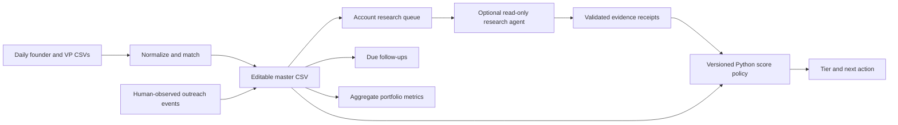

# A technical GTM system I use to organize my own job and contract search

## Problem and technical scope

Daily prospect exports are useful only if they become a reliable work queue. This Python project turns repeated Grok and authorized LinkedIn CSVs into one editable local CRM, then connects account research, explainable priorities, manually observed outreach, and follow-up reminders.

The project demonstrates technical execution in marketing/growth operations: input contracts, data normalization, identity resolution, crash recovery, API/agent boundaries, evidence lineage, structured output validation, and tests. It does not position its operator as a senior growth strategist or claim expertise unsupported by a work history.

## Engineering decisions a reviewer can inspect

- Atomic CSV replacement and pre-write backups protect spreadsheet data; SQLite holds operational checkpoints rather than another contact database.
- Stable file/row observation hashes allow daily reruns and recover the crash window between a master write and its row checkpoint.
- Email and exact normalized LinkedIn identity match deterministically. Ambiguous name/company matches stay visible for review.
- Account research is shared across contacts. The agent returns sources and judgments; fixed Python rules calculate tiers. Model/profile hashes make changes inspectable.
- Full-time and contractor eligibility are different inputs. Imported claims, missing data, business hypotheses, and observed hiring intent are kept distinct.
- Replies and connection acceptance are manual observations; an LLM cannot invent them. DNC excludes outreach actions.
- Agent execution is bounded, structured, read-only, optional, and isolated from automatic CSV scheduling. It does not send messages or applications.
- A privacy-safe report exports measured aggregates without customer/prospect lists.

## Evidence of behavior

Run the synthetic acceptance tests and inspect the implementation. Generate your current aggregate metrics with `uv run gtm portfolio-report`; do not commit the real master, research receipts, or private source lists. Demonstrate a dry-run, repeated import, a mocked crash/recovery case, a tier explanation, and an accepted-connection event on synthetic records in a separate temporary data directory.

## Outcomes to measure rather than promise

Track time spent triaging, research coverage, logged connection acceptance, positive replies, interviews, offers, and contract outcomes. Report missing denominators as unknown. A functioning system and passing tests demonstrate software behavior; they do not establish predictive hiring performance, a causal improvement in conversion, or revenue impact. Add dated evidence of actual outcomes only after they occur.
